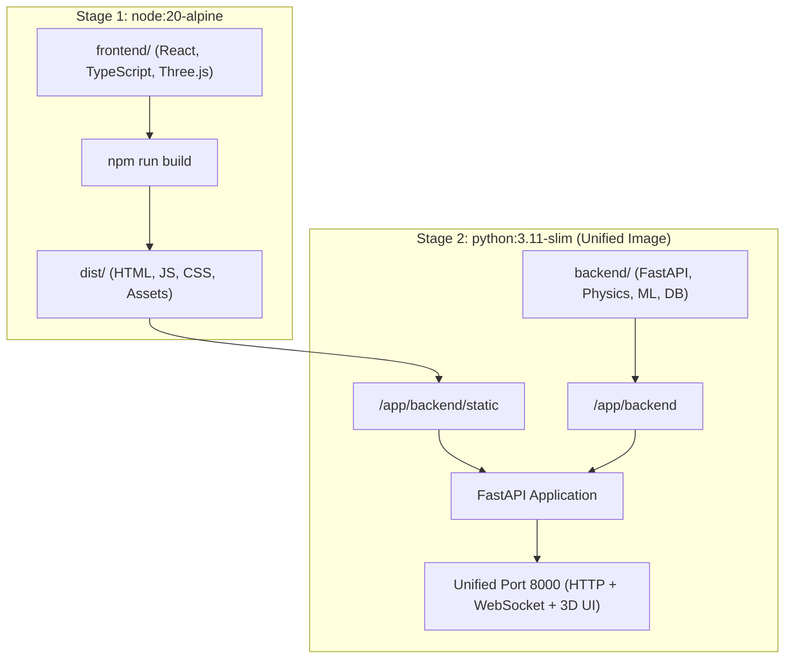

# Docker Deployment & Standalone Image Sharing Guide

## 1. Overview
The Conveyor C01 Digital Twin is packaged into a **single, self-contained, production-grade Docker image**. 

The image uses a multi-stage build:
1. **Stage 1 (Frontend Builder - Node 20)**: Compiles the React 18, TypeScript, Three.js, and Recharts frontend into optimized static assets (`dist/`).
2. **Stage 2 (Runtime - Python 3.11-slim)**: Runs FastAPI with Uvicorn, serving:
   - Real-time physics simulation loop (DIN 22101 / CEMA).
   - High-frequency WebSocket telemetry stream (`/ws/realtime`).
   - REST API endpoints (`/api/...`).
   - The compiled 3D React application directly at the root (`/`) with full client-side SPA routing (`/alarms`, `/analytics`, `/maintenance`).



---

## 2. Quick Start: Build & Run Locally

### Option A: Using 1-Click Scripts
- **Windows**: Double-click [`scripts/docker_build_run.bat`](file:///d:/sih%202026/conveyor-digital-twin/scripts/docker_build_run.bat)
- **Linux / macOS**: Run `bash scripts/docker_build_run.sh`

### Option B: Using Docker CLI
```bash
# 1. Build the production multi-stage image
docker build -t conveyor-digital-twin:latest .

# 2. Run container in background
docker run -d \
  --name conveyor-digital-twin \
  -p 8000:8000 \
  --restart unless-stopped \
  conveyor-digital-twin:latest

# 3. Open in browser
# http://localhost:8000
```

### Option C: Using Docker Compose
```bash
docker compose up --build -d
```
To stop the container:
```bash
docker compose down
```

---

## 3. How to Export & Share the Image (.tar File)

You can package the entire application into a single portable `.tar` archive file and share it with judges, evaluators, or teammates without requiring them to clone the repository or install Node.js/Python.

### Step 1: Export Image on Your Machine
Run the export script:
- **Windows**: Run [`scripts/docker_export.bat`](file:///d:/sih%202026/conveyor-digital-twin/scripts/docker_export.bat)
- **Linux / macOS**: Run `bash scripts/docker_export.sh`

Or execute via terminal:
```bash
docker save -o conveyor-digital-twin.tar conveyor-digital-twin:latest
```
This generates a single file: **`conveyor-digital-twin.tar`** (~300–450 MB compressed).

### Step 2: Share the File
Share `conveyor-digital-twin.tar` via USB drive, Google Drive, OneDrive, or network share.

### Step 3: Run on Any Recipient Machine
The recipient only needs Docker installed (Windows, Mac, or Linux):
```bash
# 1. Import the image
docker load -i conveyor-digital-twin.tar

# 2. Run the container
docker run -d -p 8000:8000 --name conveyor-digital-twin conveyor-digital-twin:latest

# 3. Open browser at
# http://localhost:8000
```
The exact same web app opens with identical 3D graphics, live telemetry, physics calibrations, and HMI controls.

---

## 4. Port Mapping & Network Configuration

| Container Port | Host Port | Protocol | Purpose |
|---|---|---|---|
| `8000` | `8000` | HTTP / WebSocket | Single unified entry point for 3D UI, REST API, and telemetry stream |

If port 8000 is occupied on the host machine, you can bind to another port (e.g. 8080):
```bash
docker run -d -p 8080:8000 conveyor-digital-twin:latest
```
Then navigate to `http://localhost:8080`. The application automatically detects the host port and connects the WebSocket telemetry seamlessly.

---

## 5. Container Verification & Healthcheck

The image includes a built-in health check:
```bash
docker inspect --format='{{json .State.Health}}' conveyor-digital-twin
```
Or check container status:
```bash
docker ps
```
The status will display `healthy` once the server has booted and responded to `/health`.
