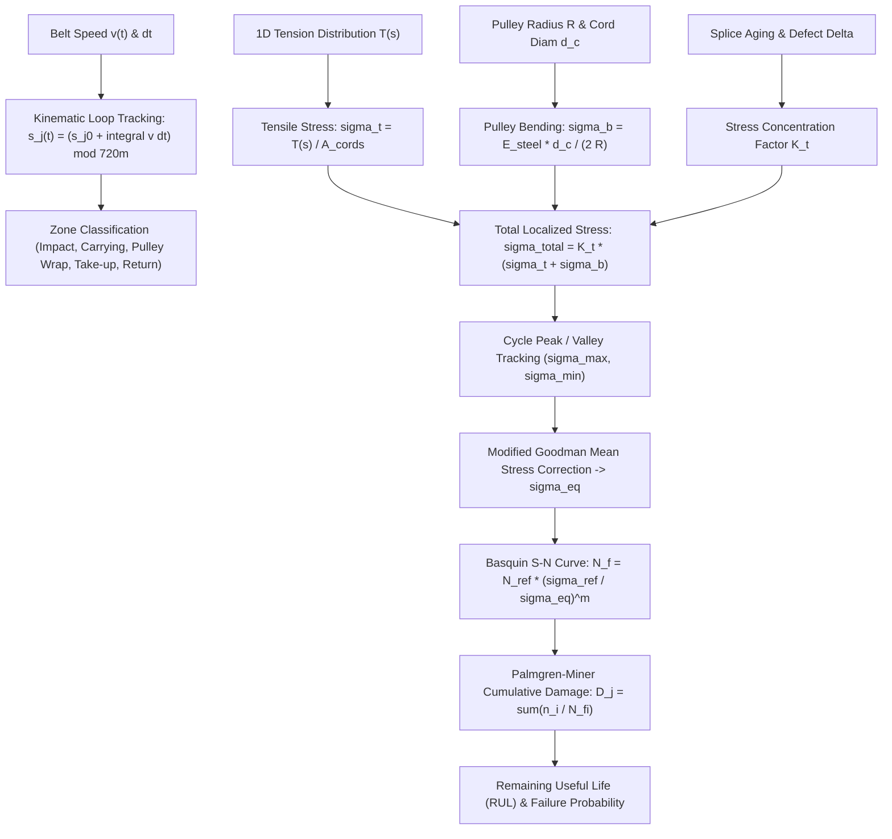

# Splice Joint Mechanics & Palmgren-Miner Cumulative Fatigue Model

## 1. Executive Overview
In long-distance, high-capacity bulk material handling conveyors, the conveyor belt represents up to $40\%$ of the total equipment capital investment, and **over $85\%$ of catastrophic belt parting failures occur at vulcanized splice joints**. 

Conveyor C01 is equipped with a **DIN 22131 ST2500 steel-cord belt** operating on a $720.0\text{ m}$ closed loop. The belt comprises 24 physical vulcanized splices. Unlike synthetic fabric belts that experience gradual elongation, steel-cord belt splices transfer load entirely through shear deformation in the interfacial bonding rubber between overlapping steel cables.

This mathematical model tracks each of the 24 splices individually through its dynamic 1D spatial coordinates, calculates instantaneous multi-axial stresses (tension + pulley wrap bending + stress concentration), applies Goodman mean stress correction, and integrates ASTM rainflow cycles into Palmgren-Miner cumulative fatigue damage.

---

## 2. 24-Joint Moving Kinematics on Closed Loop

### 2.1 Spatial Boundary Coordinates
Conveyor C01 features a center-to-center pulley length of $L = 350.0\text{ m}$ with $10.0\text{ m}$ gravity take-up loop travel:
$$L_{\text{loop}} = 2 \times 350.0 + 20.0 = 720.0\text{ m}$$

The 24 vulcanized splices are indexed $j \in \{1, 2, \dots, 24\}$ with initial nominal spacing $p = \frac{720.0}{24} = 30.0\text{ m}$:
$$s_{j,0} = (j - 1) \cdot 30.0\text{ m}$$

### 2.2 Dynamic Kinematic Position Update
At every simulation time step $\Delta t$, splice positions propagate with conveyor velocity $v(t)$:
$$s_j(t + \Delta t) = \left( s_j(t) + v(t) \cdot \Delta t \right) \bmod L_{\text{loop}}$$

### 2.3 Spatial Zone Mapping
The $720.0\text{ m}$ closed perimeter is segmented into distinct mechanical duty zones:

| Spatial Coordinate $s$ | Mechanical Zone | Dominant Loading Mechanisms |
|---|---|---|
| $0.0\text{--}40.0\text{ m}$ | `LOADING_ZONE` | Material drop impact, high dynamic indentation, accelerating cross-shear |
| $40.0\text{--}350.0\text{ m}$ | `CARRYING_RUN` | Steady high tension ($T_1 \approx 65\text{ kN}$), cyclic 3-roll troughing flexing |
| $350.0\text{--}365.0\text{ m}$ | `HEAD_PULLEY_WRAP` | Peak tension $T_1$, reverse transition wrap bending stress ($\sigma_b$) |
| $365.0\text{--}400.0\text{ m}$ | `TAKEUP_ZONE` | Counterweight dynamic oscillations, gravity take-up trolley interaction |
| $400.0\text{--}700.0\text{ m}$ | `RETURN_RUN` | Low tension ($T_2 \approx 36\text{ kN}$), 2-roll V-return idler support |
| $700.0\text{--}720.0\text{ m}$ | `TAIL_PULLEY_WRAP` | Slack tension, wrap bending stress, entry transition troughing |

---

## 3. Multi-Axial Splice Stress Formulation

### 3.1 Belt Construction & Effective Cord Area
Conveyor C01 uses a **DIN 22131 ST2500** belt specification:
- Nominal breaking strength: $K_N = 2500\text{ N/mm}$
- Belt width: $B = 1400\text{ mm}$
- Total belt breaking load: $F_{\text{break}} = K_N \cdot B = 3,500,000\text{ N} = 3,500\text{ kN}$
- Number of zinc-coated steel cords: $N_{\text{cords}} = 82$
- Steel cord diameter: $d_c = 7.2\text{ mm}$
- Cord pitch: $p_c \approx 17.0\text{ mm}$

The total effective metallic cross-sectional area is:
$$A_{\text{cords}} = N_{\text{cords}} \cdot \frac{\pi \cdot d_c^2}{4} = 82 \cdot \frac{\pi \cdot 7.2^2}{4} \approx 3338.4\text{ mm}^2 = 3.3384 \times 10^{-3}\text{ m}^2$$

### 3.2 Axial Tensile Stress
At local position $s_j(t)$ along the conveyor circuit, belt tension is $T(s_j(t))$. The nominal axial tensile stress in the steel cords is:
$$\sigma_t(s_j) = \frac{T(s_j)}{A_{\text{cords}}}$$

For nominal operating tensions:
- Tight side ($T_1 = 65.36\text{ kN}$): $\sigma_t = \frac{65,360}{3338.4} = 19.58\text{ MPa}$
- Slack side ($T_2 = 36.00\text{ kN}$): $\sigma_t = \frac{36,000}{3338.4} = 10.78\text{ MPa}$

### 3.3 Pulley Wrap Bending Stress
When a splice passes over the head pulley ($D_{\text{head}} = 0.80\text{ m}$) or tail pulley ($D_{\text{tail}} = 0.63\text{ m}$), each individual steel cord is forced to conform to the pulley curvature radius $R = D / 2$. 

From classic Euler-Bernoulli beam bending theory:
$$\sigma_b = \frac{E_{\text{steel}} \cdot d_c}{2 \cdot R}$$

Where:
- $E_{\text{steel}} = 200\text{ GPa} = 200,000\text{ MPa}$ (Modulus of elasticity of high-tensile steel cord)
- Head pulley ($R = 0.40\text{ m} = 400\text{ mm}$):
  $$\sigma_{b,\text{head}} = \frac{200,000 \cdot 7.2}{2 \cdot 400} = 1800.0\text{ kPa} = 1.80\text{ MPa}$$
- Tail pulley ($R = 0.315\text{ m} = 315\text{ mm}$):
  $$\sigma_{b,\text{tail}} = \frac{200,000 \cdot 7.2}{2 \cdot 315} = 2.29\text{ MPa}$$
- On flat carrying or return idler runs: $\sigma_b = 0\text{ MPa}$.

### 3.4 Stress Concentration Factor ($K_t$)
In a vulcanized steel-cord splice, cord ends do not touch. Tensile force transfers between adjacent overlapping cables via shear deformation in the $2\text{--}3\text{ mm}$ rubber core. The abrupt termination of cables generates a localized shear stress peak at the splice step transitions.

For a pristine DIN 22131 Step 2 vulcanized splice:
$$K_{t,\text{nom}} = 1.25$$

As the splice ages, suffers moisture ingress, rubber cord adhesion loss, or steel filament necking, the stress concentration factor increases:
$$K_t(j) = K_{t,\text{nom}} \cdot \left( 1.0 + \Delta_{\text{damage},j} \right)$$

### 3.5 Total Local Peak Stress
$$\sigma_{\text{total}}(s_j) = K_t(j) \cdot \left[ \sigma_t(s_j) + \sigma_b(s_j) \right]$$

---

## 4. Goodman Mean Stress Correction

During every complete revolution around the $720.0\text{ m}$ loop, each splice undergoes a cyclic stress fluctuation:
- Maximum stress $\sigma_{\max}$: Occurs at head pulley wrap under peak tension $T_1$ with bending stress.
- Minimum stress $\sigma_{\min}$: Occurs on the slack return strand near the tail pulley.

### 4.1 Cyclic Stress Decomposition
$$\begin{aligned}
\Delta\sigma &= \sigma_{\max} - \sigma_{\min} \quad &\text{(Stress Range)} \\
\sigma_a &= \frac{\sigma_{\max} - \sigma_{\min}}{2} \quad &\text{(Stress Amplitude)} \\
\sigma_m &= \frac{\sigma_{\max} + \sigma_{\min}}{2} \quad &\text{(Mean Tensile Stress)}
\end{aligned}$$

### 4.2 Modified Goodman Equation
Static tensile mean stress $\sigma_m$ accelerates fatigue crack propagation. To convert an asymmetric cycle $(\sigma_a, \sigma_m)$ into an equivalent zero-mean fully reversed stress amplitude $\sigma_{\text{eq}}$, we apply the Modified Goodman criterion:

$$\frac{\sigma_a}{\sigma_{\text{eq}}} + \frac{\sigma_m}{\sigma_{ut}} = 1 \implies \sigma_{\text{eq}} = \frac{\sigma_a}{1 - \frac{\sigma_m}{\sigma_{ut}}}$$

Where $\sigma_{ut}$ is the ultimate tensile strength of conveyor belt high-strength steel cord ($\sigma_{ut} = 1770.0\text{ MPa}$).

---

## 5. Basquin High-Cycle S-N Fatigue Formulation

Fatigue life in rubber-steel composite splices under cyclic shear obeys Basquin's power-law formulation:

$$N_f = N_{\text{ref}} \cdot \left( \frac{\sigma_{\text{ref}}}{\sigma_{\text{eq}}} \right)^m$$

### 5.1 Calibrated Parameters
- Baseline reference fatigue endurance: $N_{\text{ref}} = 1,000,000\text{ cycles}$ ($10^6$ belt revolutions)
- Baseline reference endurance limit: $\sigma_{\text{ref}} = 8.0\text{ MPa}$
- Basquin fatigue exponent: $m = 3.5$ (governed by rubber viscoelastic fatigue and cord-rubber fretting wear)

### 5.2 Numerical Example
At nominal full load ($1200\text{ TPH}, 3.2\text{ m/s}$):
$$\begin{aligned}
\sigma_{\max} &= 1.25 \times (19.58 + 1.80) = 26.73\text{ MPa} \\
\sigma_{\min} &= 1.25 \times 10.78 = 13.48\text{ MPa} \\
\sigma_a &= \frac{26.73 - 13.48}{2} = 6.625\text{ MPa} \\
\sigma_m &= \frac{26.73 + 13.48}{2} = 20.105\text{ MPa} \\
\sigma_{\text{eq}} &= \frac{6.625}{1 - \frac{20.105}{1770}} = 6.701\text{ MPa}
\end{aligned}$$

Calculating cycles to failure:
$$N_f = 10^6 \cdot \left( \frac{8.0}{6.701} \right)^{3.5} = 10^6 \cdot (1.1938)^{3.5} \approx 1,863,000\text{ cycles}$$

---

## 6. Palmgren-Miner Cumulative Damage Integration

Operational conveyors encounter continuously varying throughput, startup shock transients, and dynamic tension waves. Total fatigue accumulation is evaluated using the linear Palmgren-Miner rule:

$$D_j(t) = \sum_{k=1}^{N_{\text{revs}}} \frac{n_k}{N_{f,k}}$$

Where $n_k = 1$ is each completed revolution of splice $j$, and $N_{f,k}$ is the allowable fatigue limit under the specific equivalent stress experienced during that revolution.

### 6.1 Failure & Maintenance Thresholds
- **$D_j < 0.50$**: Green / Healthy ($HI \ge 80\%$)
- **$0.50 \le D_j < 0.75$**: Warning Zone ($60\% \le HI < 80\%$) - schedule ultrasonic cord scan at next shutdown
- **$0.75 \le D_j < 0.90$**: High Risk ($40\% \le HI < 60\%$) - prepare vulcanizing crew and replacement belt insert
- **$D_j \ge 0.90$**: Critical ($HI < 40\%$) - mandatory derating of conveyor speed and tonnage
- **$D_j \ge 1.00$**: Theoretical fatigue rupture / splice pullout failure.

### 6.2 Remaining Useful Life (RUL)
Given current accumulated damage $D_j$ and instantaneous cycle damage rate $\dot{D}_j$ (damage per operating hour):

$$\text{RUL}_{j,\text{hours}} = \frac{1.0 - D_j}{\dot{D}_j}$$

Where:
$$\dot{D}_j = \frac{3600 \cdot v}{L_{\text{loop}} \cdot N_{f,j}}$$

For $v = 3.2\text{ m/s}, L_{\text{loop}} = 720\text{ m}$, one revolution takes $t_{\text{rev}} = \frac{720}{3.2} = 225.0\text{ seconds}$ ($16.0\text{ revs/hour}$).
At $N_f = 1,863,000\text{ cycles}$:
$$\dot{D}_j = \frac{16.0}{1,863,000} \approx 8.588 \times 10^{-6}\text{ / hour}$$
$$\text{Nominal Splice Fatigue Life} = \frac{1.0}{8.588 \times 10^{-6}} \approx 116,400\text{ operating hours } (\approx 13.2\text{ years of 24/7 duty})$$

---

## 7. Splice Dynamic Safety Factor ($SF_j$)

According to **DIN 22101:2011** and **DIN 22131**, the dynamic splice safety factor is evaluated against the total breaking strength of the belt, accounting for splice efficiency $\eta_{\text{splice}}$:

$$SF_j(t) = \frac{F_{\text{break}} \cdot \eta_{\text{splice}}}{T_{\text{peak}}(s_j)}$$

Where:
- $F_{\text{break}} = 3,500\text{ kN}$
- Nominal vulcanized splice dynamic efficiency: $\eta_{\text{splice}} = 0.55\text{--}0.65$ (calibrated default: $0.60$)
- Nominal peak tension under full load: $T_{\text{peak}} \approx 65.36\text{ kN}$

$$SF_{\text{nominal}} = \frac{3500 \cdot 0.60}{65.36} = \frac{2100}{65.36} = 32.13$$

Under high-inertia emergency stop or starting transients with motor pull-up torque ($2.0\times$ nominal), tension spikes to $130\text{ kN}$, maintaining $SF > 16.0$, well above the DIN 22101 minimum required safety factor $SF_{\min} = 6.7$.

---

## 8. Implementation Code References
- Splice Kinematics & Stress: [`backend/app/physics/joints.py`](file:///d:/sih%202026/conveyor-digital-twin/backend/app/physics/joints.py)
- Goodman & Palmgren-Miner Fatigue: [`backend/app/physics/fatigue.py`](file:///d:/sih%202026/conveyor-digital-twin/backend/app/physics/fatigue.py)
- Configuration & Cord Geometries: [`backend/app/config/conveyor.yaml`](file:///d:/sih%202026/conveyor-digital-twin/backend/app/config/conveyor.yaml)
- Standalone Validation: [`scripts/validate_physics.py`](file:///d:/sih%202026/conveyor-digital-twin/scripts/validate_physics.py)
- Backend Unit Tests: [`backend/tests/test_physics.py`](file:///d:/sih%202026/conveyor-digital-twin/backend/tests/test_physics.py)
