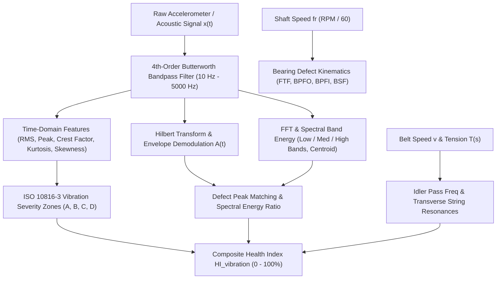

# Vibration Analysis & Condition Monitoring Mathematical Model

## 1. Executive Overview
Vibration monitoring is the primary diagnostic modality for early defect detection in the Conveyor C01 mechanical driveline. The driveline consists of a 450 kW induction motor (1485 RPM), a heavy helical-bevel gearbox (ratio $i = 12.5$), high-speed and low-speed couplings, spherical roller bearing plummer blocks supporting the head and tail pulleys, and hundreds of carrying/return idler rolls.

The digital twin combines high-frequency acoustic/accelerometer signal processing, analytical rolling-element bearing defect kinematics, structural strand resonance equations, and ISO 10816-3 severity standards to yield deterministic condition indices.



---

## 2. Signal Preprocessing Pipeline

### 2.1 Bandpass Filtering
Raw vibration signals from piezoelectric accelerometers typically contain low-frequency structural drift/thermal tilt ($< 10\text{ Hz}$) as well as high-frequency electrical switching noise and transducer mount resonance ($> 5\text{ kHz}$).

We implement a zero-phase digital 4th-order Butterworth bandpass filter:
$$H(s) = \frac{1}{\prod_{k=1}^2 (s^2 + 2 s \cos\theta_k + 1)}$$

Digital cutoff frequencies are parameterized as:
- High-pass cutoff: $f_{\text{low}} = 10.0\text{ Hz}$ (eliminates baseline wander)
- Low-pass cutoff: $f_{\text{high}} = 5000.0\text{ Hz}$ (eliminates transducer resonance)
- Digital filter order: $N = 4$

### 2.2 Windowing & Framing
Signals are framed into overlapping temporal windows with $50\%$ overlap and conditioned using a Hanning window to attenuate spectral leakage:
$$w[n] = 0.5 \left( 1 - \cos\left( \frac{2\pi n}{N_w - 1} \right) \right), \quad 0 \le n \le N_w - 1$$

---

## 3. Time-Domain Statistical Feature Extraction

For a discrete vibration burst $x = [x_1, x_2, \dots, x_N]$ with mean $\bar{x} = \frac{1}{N} \sum_{i=1}^N x_i$:

### 3.1 Root Mean Square (RMS)
Measures the total dynamic energy content of the vibration signal:
$$x_{\text{RMS}} = \sqrt{\frac{1}{N} \sum_{i=1}^N x_i^2}$$

### 3.2 Peak and Peak-to-Peak Amplitude
Quantifies the maximum instantaneous excursion:
$$x_{\text{peak}} = \max_{1 \le i \le N} |x_i|$$
$$x_{\text{p-p}} = \max_{1 \le i \le N} x_i - \min_{1 \le i \le N} x_i$$

### 3.3 Crest Factor (CF)
Dimensionless ratio of peak amplitude to RMS energy. Healthy bearings exhibit $\text{CF} \approx 2.5\text{--}3.5$. Early localized spalls cause sharp repetitive spikes that elevate $\text{CF} > 5.0$:
$$\text{CF} = \frac{x_{\text{peak}}}{x_{\text{RMS}}}$$

### 3.4 Kurtosis
Fourth standardized statistical moment. Kurtosis is exquisitely sensitive to the "tailedness" of the probability density function caused by intermittent impact shocks:
$$\text{Kurtosis} = \frac{\frac{1}{N} \sum_{i=1}^N (x_i - \bar{x})^4}{\left( \frac{1}{N} \sum_{i=1}^N (x_i - \bar{x})^2 \right)^2}$$
- **Healthy Gaussian noise**: $\text{Kurtosis} \approx 3.0$
- **Early fatigue spalling**: $\text{Kurtosis} > 4.5$ (often reaching $8.0\text{--}15.0$)
- **Late severe distributed wear**: $\text{Kurtosis}$ may paradoxically decrease back toward $3.0\text{--}4.0$ as individual impulses merge into continuous broadband roughness (which is captured by high RMS).

### 3.5 Skewness
Third standardized statistical moment measuring distribution asymmetry:
$$\text{Skewness} = \frac{\frac{1}{N} \sum_{i=1}^N (x_i - \bar{x})^3}{\left( \frac{1}{N} \sum_{i=1}^N (x_i - \bar{x})^2 \right)^{3/2}}$$

---

## 4. Frequency-Domain & Spectral Features

### 4.1 Discrete Fourier Transform & Power Spectrum
$$X[k] = \sum_{n=0}^{N-1} x[n] e^{-j 2\pi k n / N}, \quad P[k] = \frac{1}{N} |X[k]|^2$$

### 4.2 Spectral Centroid
Center of mass of the power spectrum, tracking the upward frequency migration as metal-to-metal contact and micro-spalling progress:
$$f_{\text{centroid}} = \frac{\sum_{k=0}^{N/2} f_k \cdot P[k]}{\sum_{k=0}^{N/2} P[k]}$$

### 4.3 Sub-Band Energy Distribution
The spectrum is partitioned into three diagnostically distinct frequency regimes:
1. **Low-Band ($10\text{--}100\text{ Hz}$)**: Rotational unbalance ($1\times$), mechanical misalignment ($2\times$), structural looseness ($3\times, 4\times$).
2. **Medium-Band ($100\text{--}1000\text{ Hz}$)**: Bearing fundamental pass frequencies (BPFO, BPFI, BSF) and gearbox intermediate harmonics.
3. **High-Band ($1000\text{--}5000\text{ Hz}$)**: High-order bearing resonance ringing, gear mesh fundamental ($f_{\text{gm}} = Z_{\text{pinion}} \cdot f_r$), and cavitation/rubbing.

---

## 5. Hilbert Envelope Demodulation

When a rolling element strikes a localized crack or spall on the inner or outer raceway, it excites high-frequency structural resonances (typically $2\text{--}10\text{ kHz}$) with an amplitude-modulated decay pulse. Direct FFT often fails to isolate these impacts because low-frequency mechanical vibration (unbalance, misalignment) overwhelms the spectrum.

### 5.1 Analytical Signal Formation
We apply the Hilbert Transform:
$$\tilde{x}(t) = \mathcal{H}\{x(t)\} = \frac{1}{\pi} \text{p.v.} \int_{-\infty}^\infty \frac{x(\tau)}{t - \tau} d\tau$$

The complex analytic signal $z(t)$ is:
$$z(t) = x(t) + j \tilde{x}(t)$$

### 5.2 Envelope Extraction
The instantaneous amplitude envelope $A(t)$ isolates the impact repetition rate:
$$A(t) = |z(t)| = \sqrt{x^2(t) + \tilde{x}^2(t)}$$

Taking the FFT of $A(t)$ exposes the characteristic bearing fault frequencies (BPFO, BPFI, BSF, FTF) with exceptionally high signal-to-noise ratio.

---

## 6. Rolling Element Bearing Defect Kinematics

Defect frequencies depend strictly on bearing internal geometry and rotational shaft frequency $f_r = \frac{\text{RPM}}{60}$:

$$\begin{aligned}
Z &= \text{Number of rolling elements} \\
d &= \text{Ball / roller diameter } (\text{m}) \\
D_p &= \text{Pitch circle diameter } (\text{m}) \\
\alpha &= \text{Contact angle } (\text{radians})
\end{aligned}$$

```
                +-------------------+
                |    Outer Ring     |  (Stationary in typical plummer block)
                +---------+---------+
                          |
                      (O) | Ball/Roller (Diameter d)
                          |
                +---------+---------+
                |    Inner Ring     |  (Rotates at shaft speed f_r)
================+===================+================ (Shaft Axis)
```

### 6.1 Fundamental Train Frequency (FTF / Cage Frequency)
$$f_{\text{FTF}} = \frac{f_r}{2} \left( 1 - \frac{d}{D_p} \cos\alpha \right)$$

### 6.2 Ball Pass Frequency Outer Race (BPFO)
$$f_{\text{BPFO}} = \frac{Z f_r}{2} \left( 1 - \frac{d}{D_p} \cos\alpha \right)$$

### 6.3 Ball Pass Frequency Inner Race (BPFI)
$$f_{\text{BPFI}} = \frac{Z f_r}{2} \left( 1 + \frac{d}{D_p} \cos\alpha \right)$$

### 6.4 Ball Spin Frequency (BSF)
$$f_{\text{BSF}} = \frac{D_p f_r}{2 d} \left( 1 - \left( \frac{d}{D_p} \cos\alpha \right)^2 \right)$$

### 6.5 Fundamental Geometric Invariant
Summing the inner and outer race frequencies yields an exact mathematical invariant:
$$f_{\text{BPFO}} + f_{\text{BPFI}} = Z \cdot f_r$$

### 6.6 Bearing Kinematic Table for Conveyor C01 Components
At nominal motor speed $n = 1485.0\text{ RPM}$ ($f_r = 24.75\text{ Hz}$):

| Asset Component | Bearing Model | $Z$ | $d\text{ (mm)}$ | $D_p\text{ (mm)}$ | $\alpha$ | FTF (Hz) | BPFO (Hz) | BPFI (Hz) | BSF (Hz) |
|---|---|---|---|---|---|---|---|---|---|
| **Drive Motor M01 (DE/NDE)** | SKF 6205 | 9 | 7.94 | 39.04 | $0^\circ$ | 9.86 | 88.72 | 134.03 | 58.33 |
| **Gearbox Intermediate** | SKF 6203 | 8 | 6.75 | 28.50 | $0^\circ$ | 9.44 | 75.55 | 122.45 | 49.61 |
| **Head Pulley HP01** | SKF 22220 | 18 | 24.00 | 145.00 | $12^\circ$ | 10.36 | 186.42 | 259.08 | 72.84 |

*Note: For the head pulley at $v = 3.2\text{ m/s}$ on $D_{\text{pulley}} = 0.8\text{ m}$, $f_{\text{shaft}} = \frac{3.2}{\pi \times 0.8} \approx 1.273\text{ Hz}$. Defect frequencies scale linearly with $f_{\text{shaft}}$.*

---

## 7. Belt Drive & Idler Resonance Kinematics

Vibration on the conveyor stringers and idler frames is governed by two physical phenomena:

### 7.1 Idler Roll Passing Frequency
As the belt passes over carrying or return idler rolls, roll runout and flat spots generate excitation at the roll rotational frequency:
$$f_{\text{idler}} = \frac{v}{\pi \cdot D_{\text{idler}}}$$
For nominal Conveyor C01 idler roll diameter $D_{\text{idler}} = 152.4\text{ mm}$ ($6\text{ inches}$) and belt speed $v = 3.2\text{ m/s}$:
$$f_{\text{idler}} = \frac{3.2}{\pi \times 0.1524} = 6.68\text{ Hz}$$

### 7.2 Transverse Belt Strand Natural Frequency (String Resonance)
The suspended belt span between two consecutive idler frames behaves dynamically as a prestressed tensioned string. The $n$-th transverse natural frequency is:
$$f_n = \frac{n}{2 l_{\text{span}}} \sqrt{\frac{T(s)}{q_B + q_m}}$$

Where:
- $l_{\text{span}} = 1.2\text{ m}$ (carrying idler spacing)
- $T(s) \approx 45,000\text{ N}$ (local belt tension)
- $q_B + q_m = 32.5 + 104.2 = 136.7\text{ kg/m}$

$$f_1 = \frac{1}{2 \times 1.2} \sqrt{\frac{45,000}{136.7}} = 0.4167 \times 18.14 = 7.56\text{ Hz}$$

When $f_{\text{idler}} \approx f_1$, severe mechanical resonance and ore bounce occur. The digital twin continuously monitors this proximity to prevent conveyor chute blockage and belt spillage.

---

## 8. ISO 10816-3 Vibration Severity Classification

The Conveyor C01 drive motor (450 kW) belongs to **ISO 10816-3 Group 1** (Large machines with rated power $P > 300\text{ kW}$) mounted on rigid concrete foundations.

Vibration velocity overall RMS ($10\text{--}1000\text{ Hz}$) limits:

```
  0.0                                2.3               4.5               7.1           (mm/s RMS)
   |----------------------------------|-----------------|-----------------|----------------->
               ZONE A                      ZONE B            ZONE C            ZONE D
          [Newly Installed]             [Acceptable]     [Unsatisfactory]   [Unacceptable]
             Good Health                 Continuous         Restricted         Immediate
                                         Operation          Operation             Trip
```

| Zone | Velocity RMS ($\text{mm/s}$) | Machine Condition | Twin Health Score | Action Required |
|---|---|---|---|---|
| **Zone A** | $< 2.3$ | Newly commissioned / Excellent | $90\text{--}100\%$ | Normal inspection routine |
| **Zone B** | $2.3\text{--}4.5$ | Acceptable for unrestricted continuous operation | $75\text{--}90\%$ | Baseline monitoring |
| **Zone C** | $4.5\text{--}7.1$ | Unsatisfactory for long-term continuous operation | $50\text{--}75\%$ | Schedule planned maintenance within 168 hours |
| **Zone D** | $> 7.1$ | Unacceptable / High risk of catastrophic failure | $< 50\%$ | Trigger immediate alarm and automated controlled stop |

---

## 9. Comprehensive Health Indicator Formulations

The twin synthesizes multiple sensor signals into focused diagnostic health indices:

### 9.1 Vibration Health Indicator ($HI_{\text{vibration}}$)
$$HI_{\text{vibration}} = 100 \cdot \max\left( 0.0, 1.0 - \frac{v_{\text{RMS}}}{v_{\text{crit}}} \right)$$
Where $v_{\text{crit}} = 7.1\text{ mm/s}$ (Zone D threshold).

### 9.2 Bearing Health Indicator ($HI_{\text{bearing}}$)
Combines kurtosis impulse severity and envelope demodulation energy:
$$k_{\text{norm}} = \max\left( 0.0, \frac{\text{Kurtosis} - 3.0}{7.0} \right)$$
$$HI_{\text{bearing}} = 100 \cdot \max(0.0, 1.0 - 0.5 \cdot k_{\text{norm}} - 0.5 \cdot \text{Env}_{\text{ratio}})$$

### 9.3 Splice Joint Health Indicator ($HI_{\text{joint}}$)
Evaluated dynamically per splice $j \in [1, 24]$ as a function of cumulative fatigue damage $D_j$ and local dynamic tension peak:
$$HI_{\text{joint},j} = 100 \cdot (1.0 - D_j) \cdot \left( 1.0 - \frac{\sigma_{\text{peak},j}}{\sigma_{\text{allowable}}} \right)$$

---

## 10. Implementation Code References
- Signal Preprocessing: [`backend/app/ml/vibration/preprocess.py`](file:///d:/sih%202026/conveyor-digital-twin/backend/app/ml/vibration/preprocess.py)
- Feature Extraction: [`backend/app/ml/vibration/features.py`](file:///d:/sih%202026/conveyor-digital-twin/backend/app/ml/vibration/features.py)
- Bearing Kinematics: [`backend/app/ml/vibration/bearing_frequencies.py`](file:///d:/sih%202026/conveyor-digital-twin/backend/app/ml/vibration/bearing_frequencies.py)
- Anomaly & ISO Scoring: [`backend/app/ml/vibration/anomaly.py`](file:///d:/sih%202026/conveyor-digital-twin/backend/app/ml/vibration/anomaly.py)
- Standalone Validation: [`scripts/validate_datasets.py`](file:///d:/sih%202026/conveyor-digital-twin/scripts/validate_datasets.py)
